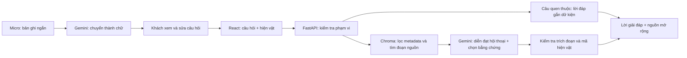

# Nội dung slide kỹ thuật AI và tài chính — bản bàn giao Quân

Nội dung này ghép vào bộ slide 16:9 của nhóm. Số liệu chi tiết xem `rag-evaluation.md`, `ai-costs.md` và `ai-cost-calculator.csv`; cần duyệt trước khi thuyết trình.

## Slide 1 — Hỏi đúng hiện vật đang xem

- Phạm vi demo: trống Ngọc Lũ, thạp Đào Thịnh và loại hình dao găm Đông Sơn.
- Khách hỏi tự nhiên, không cần biết mã sản phẩm hoặc cú pháp.
- `selectedId` của scene truyền cùng câu hỏi; ba ID hợp lệ là drum, jar và dagger.

Lời nói: “Phần AI tiếp nhận trực tiếp ngữ cảnh từ giao diện 3D. Đây là điểm nối giữa viewer của Vũ và chatbot của Phú.”

## Slide 2 — Kiến trúc AI

Lời nói: “Chúng tôi dùng RAG, đưa tư liệu đã đối chiếu vào kho truy xuất; không cần fine-tune model cho ba hiện vật này.”

## Slide 3 — Kiểm soát dữ kiện

- 46 đoạn nguồn từ 10 bài/hồ sơ; phân biệt dữ kiện, cách diễn giải và chỗ nguồn không thống nhất.
- Bộ lọc ở backend; chỉ dẫn của khách không tự sửa được phạm vi tìm kiếm.
- Lời đáp diễn đạt thân thiện, giữ bằng chứng ở nguồn mở rộng. Backend kiểm tra quote và dữ kiện số; URL nguồn lấy từ registry.
- Thiếu dữ kiện thì từ chối; dao minh họa không bị gán kích thước/xuất xứ của một mẫu khác.

Lời nói: “Chúng tôi trình bày cơ chế giảm lỗi và giới hạn đã kiểm tra; không hứa 0% bịa cho mọi câu hỏi chưa gặp.”

## Slide 4 — Kết quả demo

- 70/70 ca đạt tiêu chí của bộ mẫu hội thoại, gồm câu hỏi Telex, chất liệu, nguồn gốc, công dụng và thiếu niên đại của mẫu minh họa.
- 290 kiểm thử backend/ngữ nghĩa; 18 kiểm tra browser gồm câu trong ảnh, dừng chờ, đổi hiện vật và nguồn mở rộng.
- 20 tình huống hỏi mở/hội thoại được kiểm tra theo rubric riêng và lượt đánh giá model bổ sung, không thay thế chuyên gia.
- STT nhận đúng câu hỏi tiếng Việt tổng hợp; đánh giá micro thật/tiếng ồn vẫn cần người thử.
- Token trung bình, trung vị và P95 độ trễ lấy trực tiếp từ `rag-evaluation.md`, không dùng số phỏng đoán.

Lời nói: “Bộ mẫu có cả câu có đáp án, câu thiếu dữ kiện, lỗi gõ và yêu cầu vượt phạm vi. Kết quả này cần được mở rộng khi tăng số hiện vật.”

## Slide 5 — Chi phí theo lượt sử dụng

- Tính từ token vào/ra đo được và giá Standard tham chiếu từ Google.
- Tách chat, STT và embedding; tạo index không lặp lại ở mỗi lần mở server.
- Bảng tính có giả định số câu/khách và khách/tháng để nhóm thay đổi.
- Phải cộng hosting, lưu trữ, vận hành và phần audio của Quân khi tính toàn dự án.

Lời nói: “Đây là mô hình chi phí theo số đo, chưa phải hóa đơn hay dự báo lợi nhuận. Giá vốn in ảnh, phí thanh toán và tỷ lệ mua cần được nhóm chốt riêng.”

Nguồn giá: [Gemini Developer API pricing](https://ai.google.dev/gemini-api/docs/pricing), đối chiếu 02/11/2026. Giữ đường dẫn này trong chú thích slide tài chính để người xem kiểm tra.
